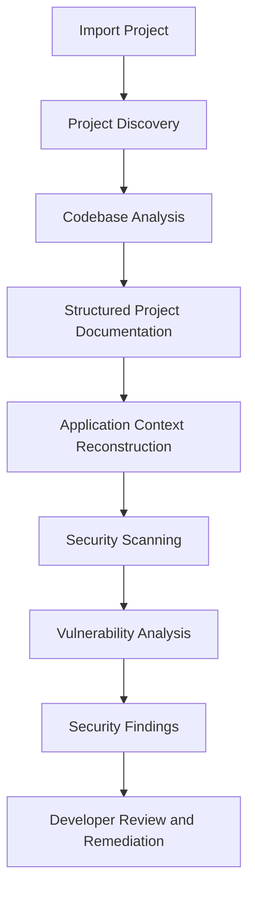

# Nigrani — AI-Powered Security Analysis Platform

**Understand. Analyze. Secure.**

Nigrani is an AI-powered security analysis platform designed to help developers identify security weaknesses in software projects through automated code understanding, structured project analysis, and vulnerability assessment.

Instead of simply running static security checks, Nigrani first builds an understanding of how a project is structured, how its components interact, and how its important operations are intended to work. It then uses this understanding to perform more context-aware security analysis.

## Problem Statement

Traditional security scanners often identify suspicious code patterns without understanding the complete application context.

This creates several challenges:

- Security findings may lack meaningful application context.
- Important vulnerabilities can exist across multiple files and components.
- Missing documentation makes security analysis difficult.
- Developers may struggle to understand why a particular implementation is insecure.
- AI-powered applications and MCP-based tool integrations introduce additional attack surfaces.

Nigrani addresses these challenges by combining project understanding with security-focused analysis.

## Key Features

### 1. Project Import and Discovery
- Import software projects through GitHub repositories.
- Analyze locally available project directories.
- Discover project structure, files, dependencies, and application components.
- Identify important entry points, APIs, configurations, and execution flows.

### 2. Automated Project Understanding

Nigrani builds a structured understanding of the imported project.

It works with 15 categories of project artifacts, covering areas such as:

- Project overview and architecture
- Component relationships
- API documentation
- Database structure
- Authentication and authorization flows
- Application workflows
- Dependency information
- Configuration details
- Data flows and security-sensitive operations

The goal is to establish a project-level understanding before performing security assessments.

### 3. AI-Assisted Security Scanning

Analyze application code and identify potential security weaknesses.

Security assessment areas include:

| Security area | What is analyzed |
|---|---|
| SQL Injection | Unsafe database query construction |
| Authentication | Weak authentication mechanisms |
| Authorization | Missing or improper access controls |
| Secrets Exposure | Hardcoded credentials and sensitive keys |
| Input Validation | Improper handling of untrusted input |
| API Security | Insecure API implementations |
| Configuration | Security-related misconfigurations |
| Dependency Security | Potentially vulnerable dependencies |

### 4. Context-Aware Vulnerability Analysis

Nigrani aims to go beyond isolated pattern matching.

By using project structure and application context, security findings can be evaluated against:
- The location of vulnerable code.
- Related functions and components.
- User-controlled input paths.
- Database and API interactions.
- Authentication and authorization boundaries.

### 5. MCP and AI Tool Security

AI applications increasingly interact with external tools through the Model Context Protocol (MCP).

Nigrani's security scope also considers risks associated with AI tool integrations, including:

- Tool poisoning
- Excessive tool permissions
- Unauthorized data access
- Sensitive information exposure
- Malicious tool behavior
- Unexpected changes in tool behavior

### 6. Security Analysis and Reporting

Security findings are organized to help developers understand and investigate potential vulnerabilities.

Reports can include:
- Vulnerability category
- Severity and risk level
- Affected file and code location
- Supporting evidence
- Explanation of the security issue
- Suggested remediation

## How Nigrani Works

The platform follows a project-understanding-first security analysis workflow.



### Workflow Explanation

1. **Import:** A developer provides a GitHub repository or local project.
2. **Discovery:** Nigrani identifies the project structure and important components.
3. **Understanding:** The codebase is analyzed to establish application context.
4. **Documentation:** Structured project artifacts are generated to represent the application's architecture and behavior.
5. **Security Scanning:** Security checks are performed on relevant parts of the application.
6. **Analysis:** Potential vulnerabilities are examined with their surrounding code context.
7. **Reporting:** Findings are presented with supporting evidence and remediation guidance.

## System Architecture

The platform consists of the following logical components:

| Component | Responsibility |
|---|---|
| Frontend | Project interaction and security findings presentation |
| FastAPI Backend | API endpoints and application orchestration |
| Project Analyzer | Repository discovery and code analysis |
| Documentation Engine | Structured project artifact generation |
| Security Scanner | Security checks and vulnerability identification |
| Background Worker | Asynchronous analysis tasks |
| Redis | Background task coordination |
| RQ | Background job execution |
| SQLAlchemy | Database interaction layer |

## Technology Stack

| Technology | Purpose |
|---|---|
| Python | Core backend and analysis logic |
| FastAPI | Backend API framework |
| SQLAlchemy | Database interaction |
| Redis | Background task infrastructure |
| RQ (Redis Queue) | Asynchronous job processing |
| AI/LLM integration | Code understanding and contextual analysis |
| Git | Repository integration |

## Security Philosophy

Nigrani follows three important principles:

**1. Understand Before Scanning**

Security analysis should consider how an application actually works rather than examining individual code patterns in isolation.

**2. Evidence-Based Findings**

Security findings should be connected to identifiable code locations and supporting evidence instead of presenting unexplained warnings.

**3. Developer-Centric Security**

The purpose of security analysis is not simply to report vulnerabilities but to help developers understand, investigate, and resolve them.

## Project Structure

```text
Nigrani/
│
├── backend/
│   ├── main.py
│   ├── worker.py
│   ├── uploads/
│   ├── requirements.txt
│   └── ...
│
├── frontend/
│   └── ...
│
├── README.md
└── ...
```

*The structure above illustrates the main application areas; individual modules may vary.*

## Getting Started

### Prerequisites

- Python 3.10+
- Redis
- Git
- pip

### Installation

**1. Clone the repository**

```bash
git clone <repository-url>
cd Nigrani
```

**2. Set up the Python environment**

```bash
cd backend
python -m venv .venv
```

Activate the environment:

Windows:
```bash
.venv\Scripts\activate
```

Linux/macOS:
```bash
source .venv/bin/activate
```

**3. Install dependencies**

```bash
pip install -r requirements.txt
```

**4. Configure environment variables**

Create a `.env` file using the environment variable template provided with the project.

Add the required database, Redis, and AI provider configuration.

**5. Start Redis**

Ensure that the Redis server is running and accessible to the backend.

**6. Start the backend**

```bash
uvicorn main:app --reload
```

**7. Start the background worker**

In a separate terminal:

```bash
python worker.py
```

## Project Objectives

- Reduce the effort required to understand unfamiliar codebases.
- Improve security analysis through application-level context.
- Identify potentially vulnerable implementation patterns.
- Make security findings easier to investigate through code-level evidence.
- Address security challenges introduced by AI-powered applications and external tool integrations.

## Future Scope

- Deeper runtime security monitoring.
- Advanced MCP tool behavior analysis.
- Automated security regression testing.
- Integration with CI/CD pipelines.
- Enhanced vulnerability verification and false-positive reduction.
- Continuous security monitoring.

## Conclusion

Nigrani aims to make application security more context-aware by connecting software understanding with vulnerability analysis.

Its central idea is simple: **a security scanner should understand the application it is protecting.**
